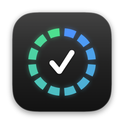
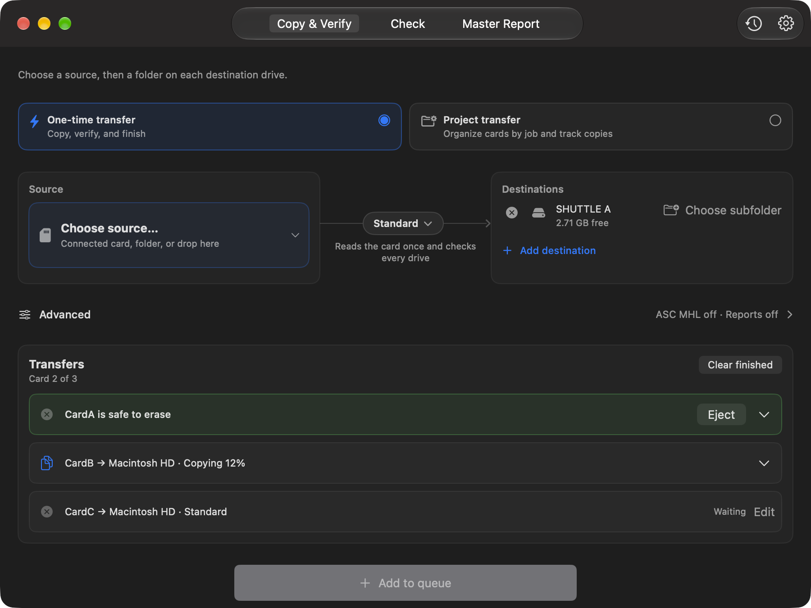

<p align="center">
  
</p>

<h1 align="center">BitMatch</h1>

<p align="center">
  <b>Free, open-source camera card offloading for Mac.</b><br>
  Copy to several drives, verify every file with SHA-256, and know exactly when the card is safe to erase.
</p>

<p align="center">
  <i>A free, open source alternative to ShotPut Pro, Silverstack, and Hedge.</i>
</p>

<p align="center">
  <a href="https://github.com/BitmatchApp/Bitmatch/releases/latest"></a>
  
  
  <a href="LICENSE"></a>
</p>

<p align="center">
  <a href="https://github.com/BitmatchApp/Bitmatch/releases/latest"><b>Download for Mac</b></a> ·
  <a href="https://bitmatchapp.github.io">Website</a> ·
  <a href="CHANGELOG.md">What's new</a> ·
  <a href="docs/GUIDE.md">Guide</a> ·
  <a href="https://github.com/BitmatchApp/Bitmatch/issues">Report a problem</a>
</p>

<p align="center">
  
</p>

For indie filmmakers, YouTubers, photographers, and small productions that don't want a subscription just to copy files.

BitMatch gets better with your help. I can test a lot here, but I can't try every camera, file format, card reader, drive, and dock people use. If something goes wrong, [file an issue](https://github.com/BitmatchApp/Bitmatch/issues). Got a question, an idea, or a setup that worked well? [Join the Discussions](https://github.com/BitmatchApp/Bitmatch/discussions). You don't have to write code to help. Real-world testing and feedback make a huge difference.

## Download

Signed and notarized macOS build on the [Releases page](https://github.com/BitmatchApp/Bitmatch/releases/latest), or with [Homebrew](https://brew.sh):

```sh
brew install --cask bitmatchapp/tap/bitmatch
```
Supports Apple Silicon and Intel Macs.

Requires **macOS 15.5 or newer**. For iPad and iPhone, build from source for now; they require **iPadOS/iOS 18.5 or newer**.

## How It Works

```text
📷 Camera Card
       │
       ▼
   BitMatch
    │    │
    ▼    ▼
  💾 A   💾 B
```

Plug in your card and drives, allow BitMatch to use them once, and it picks up the card as the source; you choose the destinations. In the default **Standard** mode, BitMatch hashes the card bytes as it copies to every drive, then reads each drive back from disk with SHA-256. **Thorough** independently rereads the card; **Paranoid** also compares bytes. **Quick** checks sizes only and never earns a safe verdict. The card is only **Safe to erase** when the required verification, coverage and evidence checks pass on every destination. Queue the next card while one copies; each card is a row that shows its own progress and verdict. Use **One-time transfer** for one card or **Project transfer** for a shoot with several cards and cameras.

Standard does not independently reread the source: a wrong source read can be copied and hashed consistently. Extra reads can catch differing bytes, but no mode can prove the original camera bytes or detect every repeatably wrong source read. See [How verification works](docs/GUIDE.md#how-verification-works) for scope and limits.

## What It Does

- **Multi destination copy**: the copy pass reads the card once and writes to every drive at the same time. Verification reads each drive back; Thorough and Paranoid also reread the card. Each destination gets its own results.
- **Careful about "safe to erase"**: a card or folder that changes during the copy, online-only iCloud/Dropbox files, or two "backups" on the same physical drive never count as safe. Recognized AppleDouble `._` metadata companions are skipped by default; other hidden files and camera sidecars stay in the copy. Turn off **Ignore AppleDouble metadata files** in **Settings → File handling** to preserve them. That copy can verify the selected files, but it won't mark the whole card safe to erase.
- **Photographer jobs** for shoots with several photographers, cameras, and cards. Save the setup instead of rebuilding it every time.
- **Camera detection** for Sony, Canon, ARRI, RED, Blackmagic, Panasonic, Fujifilm, GoPro, DJI, Insta360, and generic DCIM.
- **Check** for stuff you already copied: compare two folders, or check a backup against its saved checksums.
- **ASC MHL inventories** to hand over with your backups, so someone else can check them too.
- **PDF, CSV, and JSON reports** for producers who want documentation, or you when you want to check what happened.
- **Transfer queue and history** on Mac, iPad, and iPhone. Interrupted attempts can be reviewed and retried. Copying a card you already backed up tells you so.
- **Updates itself** on Mac: new versions arrive inside the app, signed and checked before they install.
- **Optional SFTP backup on Mac** for an off-site copy once the local one is verified.

## Verification Modes

| Mode | What it checks |
| --- | --- |
| Quick | Copy only; no checksum verification |
| Standard — default | Reads the card once; reads every drive back and checks SHA-256 |
| Thorough | Also re-reads the card; SHA-256 and MD5 |
| Paranoid | Also re-reads the card and compares every byte, plus SHA-256 |

Quick means copy only; it does **not** prove the contents match.

## Before You Trust It With Your Footage

**This is beta software from a one-person project.** I have not tested every camera, drive, filesystem, hub, or OS combination. Try it with disposable files first, keep the source card until every destination finishes cleanly, check the report, and keep another independent copy of anything you can't replace.

See the [validation status](docs/HARDWARE_COMPATIBILITY.md) and [hardware testing procedure](docs/HARDWARE_TESTING.md).

More detail (queue and recovery, ASC MHL, photographer jobs, SFTP, cards and drives, building and tests, FAQ): [the guide](docs/GUIDE.md).

## Something Went Wrong?

Keep the card, then open **History → Export diagnostics…**. If the app closed, reopen it first. Attach that file to your [bug report](https://github.com/BitmatchApp/Bitmatch/issues), along with the exact error, whether you were using **Copy & Verify** or **Check**, and the drives and dock you were using. It keeps recent transfer and Check activity across an app restart, without footage names or paths. Nothing gets sent automatically. [What it includes](docs/DIAGNOSTICS.md).

## Contributing

PRs welcome. For anything big, start a thread in [Discussions](https://github.com/BitmatchApp/Bitmatch/discussions) first so we can talk it through before you sink time into it. BitMatch is supposed to stay simple, and I'd hate for you to build something that doesn't fit.

Build both the Mac and iPad schemes before submitting. Not a coder? Testing on your own cameras, cards, readers, and drives helps just as much. So does telling me what confused you.

## License (MIT, but read this)

- **Please do** fork it, use it, improve it, credit me.
- **Please don't** change the name, put essentially the same app on the Mac or iOS App Store, and charge for it. If you ship a fork, build something of your own and give it its own name and icon.

MIT does allow independently branded forks, including App Store distribution. If you spot a listing pretending to be BitMatch, [file an issue](https://github.com/BitmatchApp/Bitmatch/issues) so I can take a look.

Built over a year of "I'll just add one more feature." Be a good person. See [LICENSE](LICENSE) for the code license and [BRANDING.md](BRANDING.md) for the name and icon.
